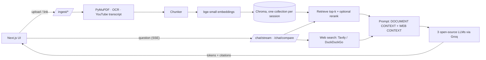

# Chat with your PDFs and YouTube videos

A full-stack RAG (retrieval-augmented generation) app. Upload a PDF or paste a YouTube link, then ask questions. Answers stream in live, cite the **exact page or video timestamp**, and can be combined with **live web search**. Pick one of three open-source models, or compare all three side by side.

## Features

- **PDF upload** with page-accurate citations (scanned PDFs are OCR'd when Tesseract is installed)
- **YouTube links** with timestamped citations that open the video at the right moment
- **Three open-source models** via any OpenAI-compatible API (Groq by default), plus **Compare mode** that streams all three in parallel with latency numbers
- **Web search toggle** (Tavily, falling back to DuckDuckGo). Web results go in a separate, labelled part of the prompt and are cited as web sources
- **Streaming answers** over Server-Sent Events, with a Stop button
- **Follow-up questions** (short chat history is sent with each request)
- **Grounded answers**: the model is told to answer only from the context and to say so when the answer isn't there
- Optional cross-encoder **reranking**, upload size limits, rate limiting, session isolation
- An **evaluation script** that benchmarks the three models on your own document

## Architecture



## Quick start (local)

You need Python 3.11+ (3.12 is the safest), Node 20+, and a free [Groq](https://console.groq.com) API key.

```bash
# 1. backend
python3.12 -m venv .venv
source .venv/bin/activate
pip install -r backend/requirements.txt
cp .env.example .env            # then open .env and set LLM_API_KEY
cd backend
uvicorn app.main:app --reload --port 8000
```

The first PDF/video you add downloads the embedding model (about 130 MB), so it takes a few minutes once.

```bash
# 2. frontend (new terminal)
cd frontend
cp .env.example .env.local
npm install
npm run dev                     # http://localhost:3000
```

Check that your model names exist at your provider:

```bash
curl -s https://api.groq.com/openai/v1/models -H "Authorization: Bearer $LLM_API_KEY" | python3 -m json.tool | grep '"id"'
```

### Optional extras

| Feature | How |
|---|---|
| Better web search | Put a free key from tavily.com in `TAVILY_API_KEY`. Without it, DuckDuckGo is used |
| OCR for scanned PDFs | `brew install tesseract` (macOS) or `apt install tesseract-ocr` |
| Videos without captions | `pip install -r backend/requirements-optional.txt`, install `ffmpeg`, set `WHISPER_FALLBACK=true` |
| Reranking | Set `RERANK_ENABLED=true` (downloads a small cross-encoder on first use) |

## Configuration

Everything is an environment variable (see `.env.example`). The important ones:

| Variable | Default | Meaning |
|---|---|---|
| `LLM_API_KEY`, `LLM_BASE_URL` | none, Groq URL | Any OpenAI-compatible provider |
| `LLM_MODEL_1/2/3`, `DEFAULT_LLM_MODEL` | gpt-oss-120b, qwen3.8-27b, gpt-oss-20b | The three models shown in the UI |
| `TAVILY_API_KEY` | empty | Enables Tavily; DuckDuckGo is the fallback |
| `CHUNK_SIZE_TOKENS` / `CHUNK_OVERLAP_TOKENS` | 600 / 100 | Chunking (word-based approximation) |
| `RETRIEVE_TOP_K` | 5 | Passages given to the model |
| `MAX_UPLOAD_MB`, `RATE_LIMIT_PER_MINUTE` | 25, 60 | Safety limits |
| `CORS_ORIGINS` | `http://localhost:3000` | Comma-separated frontend URLs |

## API

Interactive docs at http://localhost:8000/docs.

| Method | Path | Purpose |
|---|---|---|
| POST | `/ingest/pdf` | multipart `file`, optional `session_id` |
| POST | `/ingest/youtube` | `{url, session_id?}` |
| POST | `/chat` | one-shot answer + citations |
| POST | `/chat/stream` | SSE: `meta` → `token`* → `done` |
| POST | `/chat/compare` | SSE with all three models in parallel, events tagged by `model` |
| GET | `/models` | configured models |
| GET | `/sources?session_id=` | what's indexed |
| DELETE | `/sources/{source_id}?session_id=` | remove one document/video |
| DELETE | `/sessions/{session_id}` | remove everything for a session |
| GET | `/health` | liveness |

```bash
curl -N -X POST localhost:8000/chat/stream -H 'Content-Type: application/json' \
  -d '{"session_id":"demo","question":"Summarize this","model":"openai/gpt-oss-120b","web_search":false}'
```

## Tests

```bash
source .venv/bin/activate
pytest -q            # from the repo root
```

The suite (about 75 tests) needs no API keys, no network and no model downloads: it uses a fake embedder, fake LLM and a mocked HTTP layer. It covers chunking, PDF/OCR loading, vector search, source management, prompt building, streaming (including reasoning-tag stripping across chunk boundaries), compare mode, every HTTP route, upload limits, path-traversal safety and rate limiting.

## Evaluation

```bash
# edit evaluation/test_questions.json first (15-30 questions about your PDF)
python evaluation/run_eval.py --pdf path/to/doc.pdf          # add --judge for LLM grading
```

Writes `docs/eval_results.md` with median latency, keyword score, refusal rate and per-question answers for each model.

## Run with Docker

```bash
cp .env.example .env     # set LLM_API_KEY
docker compose up --build
# open http://localhost:3000
```

The compose file uses volumes so your vector database and the embedding-model cache survive restarts.

## Deployment notes

- **Frontend** (Vercel/Netlify): set `NEXT_PUBLIC_API_URL` to your backend's public URL **at build time**.
- **Backend** (Render, Railway, Fly.io, a VM, or AWS): use the Dockerfile in `backend/`. Give it a **persistent disk** mounted at `/app/data` or indexed documents vanish on every deploy. Set `CORS_ORIGINS` to your frontend URL. Free tiers with under 1 GB of RAM may struggle with the embedding model.
- **YouTube transcripts are often blocked on cloud servers.** YouTube rejects many datacenter IP ranges. If `/ingest/youtube` works locally but fails in production, that's why. Options: run the backend on a home or VPS IP, route requests through a proxy, or enable the Whisper fallback (it can still hit the same block when downloading audio).
- Run **one worker** (the default). The rate limiter is in-memory and Chroma's local files expect a single writer. For multiple instances, move to Redis and Qdrant.
- There is **no login**. A "session" is a random id kept in the browser's local storage, so anyone who knows an id can read that session's documents. Add real authentication before putting private documents on a public URL.

## Design decisions

- **One page per chunk** for PDFs, so every citation has a single correct page number.
- **Transcript windows** of about 2,400 characters for YouTube, each keeping its start/end time, which becomes the clickable timestamp.
- **Document and web context are separate prompt sections**, so the model (and the user) can tell where each claim came from.
- **`VectorStore`, `Embedder`, `LLMClient`, `WebSearcher` are interfaces.** The service layer never imports Chroma or httpx directly, which is also what makes the tests fast and offline.
- **Reasoning models**: `<think>…</think>` blocks are stripped from both full and streamed answers, even when a tag is split across chunks.
- **Compare mode retrieves once** and shares the context with all three models, so differences come from the models, not from retrieval.

## Known limitations

- Token counts are word counts, not a real tokenizer
- The in-memory rate limiter resets on restart and is per process
- Whisper fallback, Tesseract OCR and the Docker image depend on tools that aren't part of the default install
- Only English OCR is configured; the YouTube loader prefers English/Hindi captions but accepts any language
- Retrieval uses the latest question only (follow-ups like "and the second one?" may retrieve poorly)

## Project layout

```
.
├── backend/app/
│   ├── main.py  config.py
│   ├── api/         routes_ingest · routes_chat · routes_sources · sse · deps
│   ├── ingestion/   pdf_loader · youtube_loader · youtube_whisper · chunker · pipeline
│   ├── retrieval/   embedder · vector_store · reranker · web_search
│   ├── llm/         base · providers (OpenAI-compatible, streaming) · prompts
│   ├── services/    rag_service
│   └── utils/       ids · logging · rate_limit
├── backend/tests/
├── frontend/src/    app · components · hooks/useChat · lib/api
├── evaluation/      run_eval.py · test_questions.json
├── docker-compose.yml  .env.example
└── docs/
```
